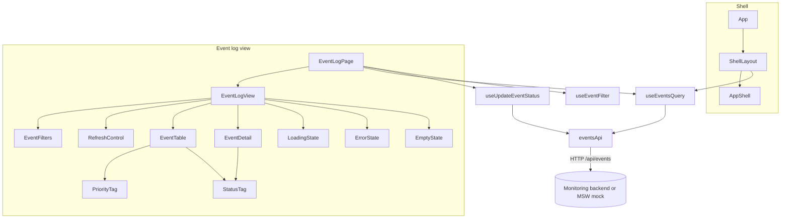
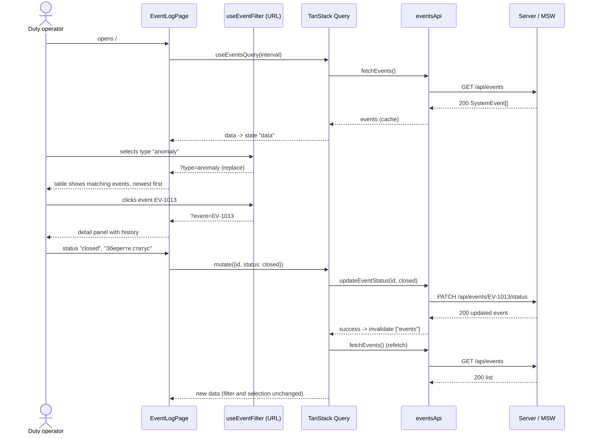
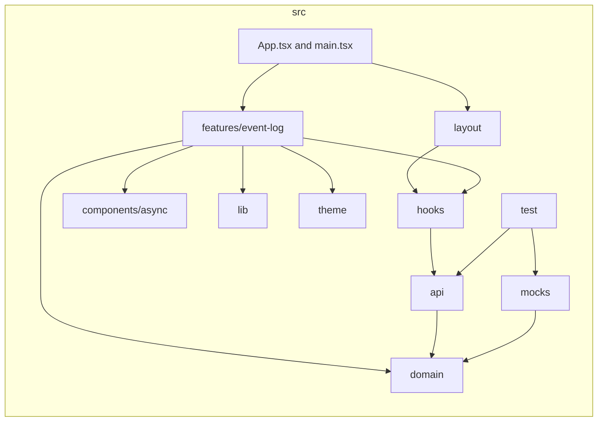

# Architecture

The interface is a single-page React application for the duty operator's event log (ARGUS, topic 1). It shows the event stream, lets the operator filter and select events, and records status changes. It has no targeting or weapon functions (C3, N6).

## 1. Views, routes and transitions

| Route                | View                       | Purpose                                               |
| -------------------- | -------------------------- | ----------------------------------------------------- |
| `/`                  | Event log (`EventLogPage`) | Table of events, filters, detail panel, status change |
| `*` (any other path) | Redirect to `/`            | Unknown addresses lead to the only view               |

The event log is the only view. Its four states (R9) are rendered by the same page:

| State      | Trigger                                                           | What the operator sees                                                  |
| ---------- | ----------------------------------------------------------------- | ----------------------------------------------------------------------- |
| Loading    | First request is pending                                          | Loading indicator with text                                             |
| Error      | First request failed (after one retry)                            | Error notification and a "Повторити" (retry) button                     |
| Empty data | Request succeeded with no events, or no event matches the filters | Message explaining why, plus "Скинути всі фільтри" when filters are set |
| Data       | At least one event is visible                                     | Table, detail panel (or its "select an event" hint)                     |

**Transitions.** The page has no separate screens. Transitions happen inside the view:

- filter change: the URL query string changes (`?type=anomaly&q=…`), the table is recomputed from the cached list;
- row selection: the URL gets `event=<id>`, the detail panel shows that event;
- status change: `PATCH /api/events/:id/status`, then the list is invalidated and reloaded;
- auto-refresh tick: the list is reloaded in the background, the URL state is untouched, so the filter and selection stay.

## 2. Components

| Component                                  | Kind           | Location                                    | Responsibility                                                                    |
| ------------------------------------------ | -------------- | ------------------------------------------- | --------------------------------------------------------------------------------- |
| `App`                                      | Routing        | `src/App.tsx`                               | Routes; wraps everything in the Carbon `Theme`                                    |
| `ShellLayout`                              | Container      | `src/layout/ShellLayout.tsx`                | Loads the shared event list for the header counter                                |
| `AppShell`                                 | Presentational | `src/layout/AppShell.tsx`                   | Carbon header with title and high-priority counter (R8), skip link, content frame |
| `EventLogPage`                             | Container      | `src/features/event-log/EventLogPage.tsx`   | Connects queries, mutation, URL state and refresh interval to the view            |
| `EventLogView`                             | Presentational | `src/features/event-log/EventLogView.tsx`   | Lays out toolbar, table and detail; selects the state to show                     |
| `EventFilters`                             | Presentational | `src/features/event-log/EventFilters.tsx`   | Search, type, zone, status, time range and "clear all" (R4, R5)                   |
| `RefreshControl`                           | Presentational | `src/features/event-log/RefreshControl.tsx` | Auto-refresh interval (R3)                                                        |
| `EventTable`                               | Presentational | `src/features/event-log/EventTable.tsx`     | Event rows, selection, high-priority marking (R1, R2, R8)                         |
| `StatusTag`, `PriorityTag`                 | Presentational | `src/features/event-log/StatusTag.tsx`      | Carbon tags for status and priority                                               |
| `EventDetail`                              | Presentational | `src/features/event-log/EventDetail.tsx`    | Attributes, local and UTC time, status control, history (R6, R7, N5)              |
| `LoadingState`, `ErrorState`, `EmptyState` | Presentational | `src/components/async/`                     | Shared state components (R9)                                                      |

Hooks and helpers:

| Module                                                                                   | Responsibility                                   |
| ---------------------------------------------------------------------------------------- | ------------------------------------------------ |
| `useEventsQuery`, `useUpdateEventStatus` (`src/hooks/useEvents.ts`)                      | TanStack Query wrappers around the API client    |
| `useEventFilter` (`src/features/event-log/useEventFilter.ts`)                            | Reads and writes filter and selection in the URL |
| `applyFilter`, `sortNewestFirst`, `countUnprocessedHighPriority` (`src/domain/event.ts`) | Pure domain logic (R2, R4, R8)                   |
| `formatLocal`, `formatUtc`, `formatUtcOffset` (`src/lib/time.ts`)                        | Time presentation (N5, C5)                       |
| `fetchEvents`, `updateEventStatus` (`src/api/eventsApi.ts`)                              | HTTP client; `ApiError` carries the status       |

## 3. Diagrams

### 3.1 Component diagram

### 3.2 Sequence diagram: main scenario

The operator filters by type, opens an event, and closes it (T2, T3, T4).

### 3.3 Package diagram

Stories (`*.stories.tsx`) import from components and from `mocks` for sample data only; they do not use the network.

## 4. State placement

| State                                | Where it lives                         | Why                                                                                   |
| ------------------------------------ | -------------------------------------- | ------------------------------------------------------------------------------------- |
| Event list (server data)             | TanStack Query cache, key `['events']` | Shared by the header counter and the log; refreshed by polling (R3)                   |
| Filter and selected event            | URL query string                       | Survives refresh and reload; can be shared as a link; no global store needed (R3, R5) |
| Refresh interval                     | `useState` in `EventLogPage`           | UI preference for the current session                                                 |
| Status draft in the detail panel     | `useState` in `SelectedEventDetail`    | Not saved until the operator confirms (R7)                                            |
| Save status (pending, error)         | TanStack mutation state                | Drives the "Збереження…" label and the error notification                             |
| Mock configuration (latency, errors) | `src/mocks/config.ts`                  | Only used by MSW and tests                                                            |

## 5. Data flow and data exchange

- The API client (`src/api/eventsApi.ts`) is the only place that calls `fetch`. It sends `GET /api/events` and `PATCH /api/events/:id/status` with a JSON body `{ "status": "..." }`.
- Times travel as ISO 8601 UTC strings. The UI converts them to local time for the table and shows UTC and the offset in the detail panel (N5).
- Filtering and sorting run in the browser on the cached list (`applyFilter`, `sortNewestFirst`). A shift produces a limited number of events, so this is cheaper than a round trip per filter change.
- In development, MSW (`src/mocks/browser.ts`) answers the API calls; in tests, the same handlers run in Node (`src/mocks/server.ts`).

## 6. Target screen widths

| Width               | Layout                                                                                                                                    |
| ------------------- | ----------------------------------------------------------------------------------------------------------------------------------------- |
| 1440 px and 1280 px | Toolbar on top; table on the left and detail panel on the right (from 1280 px)                                                            |
| 1024 px             | One column: toolbar, table, then detail panel; the table scrolls inside its own container if needed, the page never scrolls sideways (N1) |

Breakpoint: `min-width: 1280px` for the two-column body (`src/styles/app.css`).
